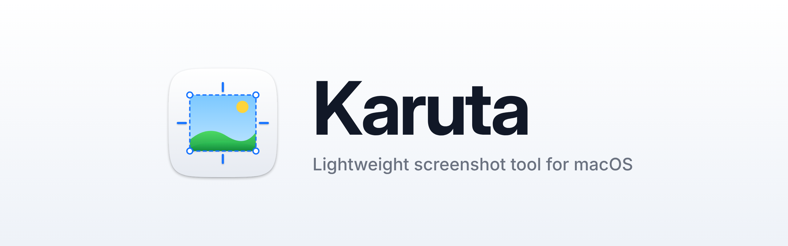

<picture>
  <source media="(prefers-color-scheme: dark)" srcset="docs/banner-dark.png">
  
</picture>

# Karuta

個人用の軽量スクリーンショットアプリ（macOS 14 以上）。CleanShot X を参考に、必要な機能だけを小さく作っています。

## 方針

- メニューバー常駐のみ（Dock アイコンなし）
- AppKit と ScreenCaptureKit だけで作り、外部ライブラリは使わない
- ウィンドウは使うときだけ作り、撮影した画像はすぐ解放する

### 作らない機能

- **OCR（画面の文字認識）:** TextSniper を購入して使っているので、Karuta では作りません。
- **Cloud（アップロードと共有リンク）:** 作りません。

## 機能

| ショートカット | 動作 |
| --- | --- |
| ⌘⇧4 | 範囲を撮影（Space でウィンドウ選択に切り替え、Esc でキャンセル） |
| ⌘⇧5 | ウィンドウを撮影（クリックしたウィンドウ） |
| ⌘⇧3 | マウスがある画面の全画面を撮影 |

⌘⇧3 / ⌘⇧4 / ⌘⇧5 は macOS 標準のスクリーンショットと同じキーなので、標準側をオフにしてください。「システム設定」>「キーボード」>「キーボードショートカット…」>「スクリーンショット」を開き、すべてのチェックを外します。

範囲選択は画面を一時停止した状態で行います（動画やメニューが動いても選んだ瞬間のまま撮れます）。

- カーソルに十字ガイドと拡大鏡（座標つき）が付き、ドラッグ中はサイズ（pt）を表示
- Shift: 正方形 / Option: 中心から広げる / Space を押したまま: 選択範囲ごと移動
- 矢印キーでカーソルを 1pt ずつ（Shift で 10pt）動かせます。ドラッグ中でも使えます
- ドラッグ前に Space でウィンドウ選択に切り替え。クリックか Return で撮影
- Esc か右クリックでキャンセル

撮影後は左下にクイックアクセスオーバーレイ（サムネイル）が出ます。続けて撮ると上に積み重なります（最大 5 枚）。

- カーソルを乗せると「コピー」「保存」と、四隅に「閉じる」「ピン留め」「編集」のボタンが出ます
- 乗せている間は ⌘C コピー / ⌘S 保存 / ⌘E 編集 / ⌘P ピン留め / ⌘W・Esc 閉じる
- サムネイルを Finder や他のアプリへドラッグするとファイルとして渡せます
- 2 本指で横にスワイプすると消えます。ダブルクリックで編集
- 右クリックでメニュー（コピー・保存・別名で保存・編集・ピン留め・閉じる・すべて保存・すべて閉じる）
- 右下のボタンでスタックごと画面の左端に隠せます。端に残るタブをクリックすると戻ります（新しく撮っても戻ります）
- ピン留めした画像は最前面に浮きます。ドラッグで移動、スクロールで拡大縮小、⌥+スクロールで透明度、⌘C でコピー、Esc で閉じる

メニューの「前回の範囲を撮影」で、直前に選んだ範囲をもう一度撮れます。

**All-In-One**（メニュー、またはショートカットを設定で割り当て）: 範囲をドラッグしても撮らずに残し、四隅と辺のハンドルで大きさを、内側のドラッグか矢印キーで位置を直せます（前回の範囲から始まります）。下のバーで幅と高さを数字で入れたり、縦横比（1:1・4:3・16:9 など）を固定したりできます。Return か「撮影」で撮影後の動作どおりに、ほかのボタンでセルフタイマー・ピン留め・編集・保存・コピーだけを行います。

- セルフタイマー: 範囲（Space でウィンドウ）を選ぶと、カウントダウンのあと撮ります（3 / 5 / 10 秒、設定 >「スクリーンショット」）。メニューを開いた状態などを撮るときに。カウントダウンをクリックすると中止
- 範囲を選び終えるときに ⌃ を押していると、撮影後の動作の設定にかかわらずコピーだけします
- 「範囲を撮影してコピー / 保存 / 編集 / ピン留め」は、その動作だけを行います（ショートカットは設定で割り当て）
- メニューから「クリップボードの画像を編集」「画像を開いて編集…」「画像をピン留め…」「最近閉じたものを戻す」（直近 5 枚）も使えます

### 設定（メニュー >「設定…」/ ⌘,）

左のサイドバーでページを切り替えます。

- 一般: ログイン時に起動 / メニューバーのアイコン（隠したときは Karuta をもう一度開くと設定が出ます）/ 撮影時にデスクトップのアイコンを隠す / サウンドとシャッター音 / 保存先 / 撮影後の動作（クイックアクセス・コピー・保存・エディタを開く）
- ショートカット: 欄をクリックして新しいキーを押す。Delete で解除、Esc で取り消し。撮影・一般・クイックアクセス（隠す / 表示・すべて保存・すべて閉じる）の各操作に割り当てられます
- クイックアクセス: サムネイルを表示 / 自動で閉じるまでの時間
- スクリーンショット: 形式（PNG・JPEG・HEIC）/ ファイル名（{date} {time} {app} が使えます）/ Retina を 1x に縮小 / マウスカーソルを写す / 撮影後に背景を付ける（付けない・ウィンドウ撮影だけ・すべて）/ 画面を止めて選ぶ / 拡大鏡 / セルフタイマーの秒数

### 注釈エディタ

クイックアクセスの「編集」を押すか、サムネイルをダブルクリックすると開きます（設定で撮影後に毎回開くこともできます）。

| ツール | キー | 使い方 |
| --- | --- | --- |
| 選択 | V | クリックで選んでドラッグで移動。⌥+ドラッグで複製、Delete で削除 |
| 切り抜き | C | ドラッグで範囲を決め、Return で確定（Esc で解除） |
| 四角 / 塗りつぶし四角 / 楕円 | R / F / E | ドラッグ（Shift で正方形・正円） |
| 線 / 矢印 | L / A | ドラッグ（Shift で 45° 単位） |
| 文字 | T | クリックして入力し、Enter で確定 |
| モザイク / ぼかし | P / U | ドラッグした範囲 |
| スポットライト | H | ドラッグした範囲以外を暗くする |
| 番号 | S | クリックするたびに 1, 2, 3… |
| ペン / 蛍光ペン | D / M | ドラッグ |
| 背景 | B | 背景と余白を付ける。ボタンからグラデーション・単色・壁紙・好きな画像を選べ、余白も調整できる |

- ツールバーで色と太さを選べます（選択中の注釈にも反映）
- ⌘Z 取り消し / ⌘⇧Z やり直し / - と = でズーム、0 でフィット
- Done でクイックアクセスに戻す / Save as… で場所を選んで保存 / ⌘S で保存先に保存 / ⌘C でコピー
- 下のバー: ズーム、「Drag Me」をドラッグしてファイルとして渡す、共有・ピン留め・コピー

## ビルド

Xcode（またはコマンドラインツール）が入った Mac で:

```sh
make run       # build/Karuta.app を作って起動
make install   # /Applications にコピー
```

初回起動時に「画面収録」の許可を求められます。許可したあと、アプリを一度終了してから起動し直してください。

### 再ビルドのたびに許可を求められる場合

標準ではアドホック署名なので、ビルドするたびに macOS から別アプリとみなされることがあります。キーチェーンアクセスの「証明書アシスタント」でコード署名用の自己署名証明書（例: `Karuta Dev`）を作り、次のようにビルドすると許可が維持されます。

```sh
make install SIGN_IDENTITY="Karuta Dev"
```

### アイコン

アプリアイコンの元データは `Support/AppIcon.svg` です。変更したら `make icon`（要 `brew install librsvg`、あると小さくなる `pngquant`）で `Support/AppIcon.icns` を作り直してコミットしてください。メニューバーのアイコンは SF Symbols の `rectangle.dashed` です。

## DMG で配布する

最新版のダウンロード: [Karuta.dmg](https://github.com/trkw/karuta/releases/latest/download/Karuta.dmg)（[リリース一覧](https://github.com/trkw/karuta/releases)）

```sh
make dmg   # build/Karuta-<バージョン>.dmg を作成
```

リリースは次のどれかで作られます。DMG は GitHub Release に添付されます。

- **バージョンを上げて main にマージする：** `Support/Info.plist` の `CFBundleShortVersionString` を上げると、そのバージョンのリリースがまだなければ自動で作られます。
- **タグを push する：** `git tag v0.2.0 && git push origin v0.2.0`
- **Actions タブから実行する：** 「Release」ワークフローの「Run workflow」にバージョンを入れて実行します。

PR や main への push でも DMG がビルドされ、Actions の実行結果からダウンロードできます（7 日間保存）。

### 署名と公証

GitHub Actions の Secrets に Developer ID の証明書と App Store Connect API の鍵が登録されていれば、CI が Karuta.app と DMG を Developer ID で署名し、Apple の公証を受けて印を留めます（`scripts/sign-and-notarize.sh`）。ダウンロードした DMG をそのまま開いても警告は出ず、署名が変わらないので更新しても画面収録の許可が維持されます。鍵の作り方と登録は [docs/signing.md](docs/signing.md) を見てください。

鍵が登録されていなければ、これまでどおりアドホック署名の DMG を作ります。その場合は初回起動時に Gatekeeper にブロックされるので、Applications にコピーしたあと次のどちらかで開いてください。

- 「システム設定」>「プライバシーとセキュリティ」に出る「このまま開く」を押す
- ターミナルで `xattr -dr com.apple.quarantine /Applications/Karuta.app` を実行する

## ライセンス

[MIT](LICENSE)

## CleanShot X との差

CleanShot X の公開情報から挙動を洗い出した機能差と、実装の順番を [docs/cleanshot-gap.md](docs/cleanshot-gap.md) にまとめています。
