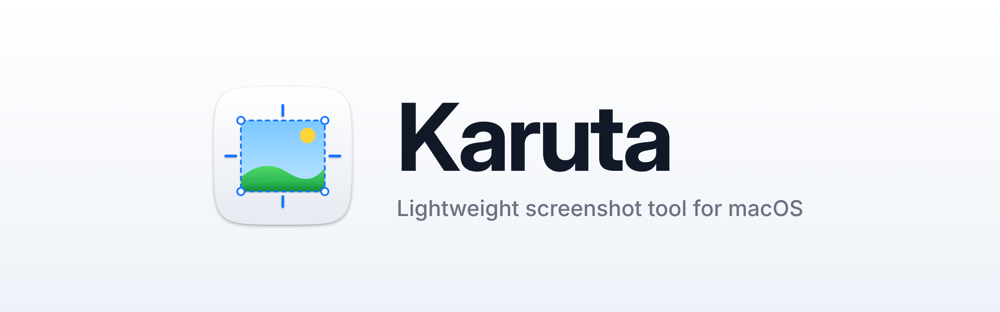

<picture>
  <source media="(prefers-color-scheme: dark)" srcset="docs/banner-dark.png">
  
</picture>

# Karuta

個人用の軽量スクリーンショットアプリ（macOS 14 以上）。CleanShot X を参考に、必要な機能だけを小さく作っています。

## 方針

- メニューバー常駐のみ（Dock アイコンなし）
- AppKit と ScreenCaptureKit だけで作り、外部ライブラリは使わない
- ウィンドウは使うときだけ作り、撮影した画像はすぐ解放する

### 作らない機能

- **OCR（画面の文字認識）:** TextSniper を購入して使っているので、Karuta では作りません。
- **Cloud（アップロードと共有リンク）:** 作りません。

## 機能

| ショートカット | 動作 |
| --- | --- |
| ⌘⇧4 | 範囲を撮影（Space でウィンドウ選択に切り替え、Esc でキャンセル） |
| ⌘⇧5 | ウィンドウを撮影（クリックしたウィンドウ） |
| ⌘⇧3 | マウスがある画面の全画面を撮影 |

⌘⇧3 / ⌘⇧4 / ⌘⇧5 は macOS 標準のスクリーンショットと同じキーなので、標準側をオフにしてください。「システム設定」>「キーボード」>「キーボードショートカット…」>「スクリーンショット」を開き、すべてのチェックを外します。

範囲選択は画面を一時停止した状態で行います（動画やメニューが動いても選んだ瞬間のまま撮れます）。

- カーソルに十字ガイドと拡大鏡（座標つき）が付き、ドラッグ中はサイズ（pt）を表示
- Shift: 正方形 / Option: 中心から広げる / Space を押したまま: 選択範囲ごと移動
- 矢印キーでカーソルを 1pt ずつ（Shift で 10pt）動かせます。ドラッグ中でも使えます
- A で縦横比を固定（自由 → 1:1 → 4:3 → 3:2 → 16:9 → 9:16 の順に切り替え、次回も同じ比で始まります）
- F で設定の「決まったサイズ」の枠に切り替え。枠はカーソルについてくるので、クリックか Return で撮影します（もう一度 F で戻る）
- ドラッグ前に Space でウィンドウ選択に切り替え。クリックか Return で撮影
- Esc か右クリックでキャンセル

撮影後は左下にクイックアクセスオーバーレイ（サムネイル）が出ます。続けて撮ると上に積み重なります（最大 5 枚）。

- カーソルを乗せると「コピー」「保存」と、四隅に「閉じる」「ピン留め」「編集」のボタンが出ます
- 乗せている間は ⌘C コピー / ⌘S 保存 / ⌘E 編集 / ⌘P ピン留め / ⌘W・Esc 閉じる
- サムネイルを Finder や他のアプリへドラッグするとファイルとして渡せます
- 2 本指で横にスワイプすると消えます。ダブルクリックで編集
- 右クリックでメニュー（コピー・保存・別名で保存・編集・ピン留め・閉じる・すべて保存・すべて閉じる）
- 別名で保存のパネルでは、下の「形式」でその画像だけ PNG・JPEG・HEIC を選べます（初めは設定の形式。設定は変わりません）
- 右下のボタンでスタックごと画面の左端に隠せます。端に残るタブをクリックすると戻ります（新しく撮っても戻ります）
- ピン留めした画像は最前面に浮きます。ドラッグか矢印キー（Shift で 10pt）で移動、スクロールで拡大縮小、⌥+スクロールで透明度、⌘C でコピー、Esc・中クリックで閉じる
- ピンの右クリック: コピー・別名で保存・編集・影の切り替え・ロック（クリックを下のアプリに通す）・閉じる・すべて閉じる。ロックの解除、全部隠す / 表示、全部閉じるはメニューバーかショートカットから
- サムネイルの位置（左下 / 右下）と大きさ（小・中・大）は 設定 >「クイックアクセス」で選べます

メニューの「前回の範囲を撮影」で、直前に選んだ範囲をもう一度撮れます。

設定 >「一般」の撮影後の動作で「範囲キャプチャをクリップボードにコピー」をオンにすると、範囲で撮ったもの（スクロールキャプチャを含む）はほかの動作と合わせてクリップボードにもコピーします。全画面・ウィンドウ・画面収録は「クリップボードにコピー」の設定に従います（両方オンでもコピーは 1 回）。

**撮影履歴**（メニュー >「撮影履歴…」）: 撮ったものが新しい順に並びます（範囲・ウィンドウ・全画面で絞り込み）。ダブルクリックで編集、右クリックでコピー・別名で保存・ピン留め・クイックアクセスに表示・Finder で表示・削除。Delete で選んだものを削除。残す期間は 設定 >「一般」で選べます（残さない / 1 日 / 1 週間 / 1 か月、既定は 1 週間）。

**All-In-One**（メニュー、またはショートカットを設定で割り当て）: 範囲をドラッグしても撮らずに残し、四隅と辺のハンドルで大きさを、内側のドラッグか矢印キーで位置を直せます（前回の範囲から始まります）。下のバーで幅と高さを数字で入れたり、縦横比（1:1・4:3・16:9 など）を固定したりできます。Return か「撮影」で撮影後の動作どおりに、ほかのボタンでセルフタイマー・ピン留め・編集・保存・コピーだけを行います。

- セルフタイマー: 範囲（Space でウィンドウ）を選ぶと、カウントダウンのあと撮ります（3 / 5 / 10 秒、設定 >「スクリーンショット」）。メニューを開いた状態などを撮るときに。カウントダウンをクリックすると中止
- 範囲を選び終えるときに ⌃ を押していると、撮影後の動作の設定にかかわらずコピーだけします
- 「範囲を撮影してコピー / 保存 / 編集 / ピン留め」は、その動作だけを行います（ショートカットは設定で割り当て）
- **スクロールキャプチャ**（メニュー >「スクロールキャプチャ」）: 範囲（Space でウィンドウ）を選んでからスクロールすると、新しく見えた部分を下へつなげて 1 枚の縦長の画像にします。上下に固定されたヘッダーやツールバーは 1 回だけ入ります。「自動スクロール」で自動で下まで送り、ページの終わりで止まります（アクセシビリティの許可が要ります）。「完了」か同じショートカットで仕上げます
- **画面収録**（メニュー >「画面を収録 / 停止」、ショートカットは設定で割り当て）: 範囲（Space でウィンドウ）を選ぶと、カウントダウンのあと MP4 か GIF で収録します（設定 >「画面収録」で形式・30 / 60 fps・カウントダウン・Mac の音・クリックの表示〔macOS 15 以降〕を選べます）。収録中は範囲が赤い点線で囲まれ、メニューバーのアイコンが経過時間付きの停止ボタンになります（クリックか同じショートカットで停止）。止めると撮影後の動作の設定どおりにクイックアクセスへ出ます。カードの「編集」は QuickTime Player などで開き（トリムはそちらで）、コピーはファイルとして貼り付けられます
- メニューから「クリップボードの画像を編集」「画像を開いて編集…」「画像をピン留め…」「最近閉じたものを戻す」（直近 5 枚）も使えます

### 設定（メニュー >「設定…」/ ⌘,）

左のサイドバーでページを切り替えます。

- 一般: ログイン時に起動 / メニューバーのアイコン（隠したときは Karuta をもう一度開くと設定が出ます）/ 撮影時にデスクトップのアイコンを隠す / サウンドとシャッター音 / 保存先 / 撮影後の動作（クイックアクセス・コピー・範囲キャプチャだけコピー・保存・エディタを開く）
- ショートカット: 欄をクリックして新しいキーを押す。Delete で解除、Esc で取り消し。撮影・一般・クイックアクセス（隠す / 表示・すべて保存・すべて閉じる）の各操作に割り当てられます
- クイックアクセス: サムネイルを表示 / 自動で閉じるまでの時間
- スクリーンショット: 形式（PNG・JPEG・HEIC）/ ファイル名（{date} {time} {app} が使えます）/ Retina を 1x に縮小 / コピーにファイルも付ける（オンにすると、画像のコピーで形式どおりのファイルもクリップボードに入り、Finder やチャットにファイルとして貼れる。既定はオフ）/ マウスカーソルを写す / 撮影後に背景を付ける（付けない・ウィンドウ撮影だけ・すべて）/ 画面を止めて選ぶ / 拡大鏡 / 範囲の縦横比 / 決まったサイズ（例: 1280x720）/ セルフタイマーの秒数

### 注釈エディタ

クイックアクセスの「編集」を押すか、サムネイルをダブルクリックすると開きます（設定で撮影後に毎回開くこともできます）。

| ツール | キー | 使い方 |
| --- | --- | --- |
| 選択 | V | クリックで選んでドラッグで移動。⌥+ドラッグで複製、Delete で削除 |
| 切り抜き | C | ドラッグで範囲を決め、Return で確定（Esc で解除） |
| 四角 / 塗りつぶし四角 / 楕円 | R / F / E | ドラッグ（Shift で正方形・正円） |
| 線 / 矢印 | L / A | ドラッグ（Shift で 45° 単位）。矢印は標準・線の矢じり・両端・曲線から選べる |
| 文字 | T | クリックして入力し、Enter で確定。縁取り・背景付き・文字だけ・影付き |
| モザイク / ぼかし | P / U | ドラッグした範囲。モザイクは黒塗りにも切り替えられる |
| スポットライト | H | ドラッグした範囲以外を暗くする |
| 番号 | S | クリックするたびに 1, 2, 3…（A B C・a b c も）。次の番号はツールバーで変えられる |
| ペン / 蛍光ペン | D / M | ドラッグ |
| 背景 | B | 背景と余白を付ける。ボタンからグラデーション・単色・壁紙・好きな画像を選べ、余白も調整できる |

- ツールバーで色と太さを選べます（選択中の注釈にも反映）。1〜6 キーでも太さを変えられます
- 色のメニューから、画面の色を取る・ほかの色を選ぶ・今の色を保存（最大 8 色）ができます
- ツールの見た目（矢印・文字・モザイク・番号）はツールバーの右側で選び、次回も引き継ぎます
- ⌘D で選択中の注釈を複製 / ⌘P で印刷
- ⌘Z 取り消し / ⌘⇧Z やり直し / - と = でズーム、0 でフィット
- Done でクイックアクセスに戻す / Save as… で場所を選んで保存 / ⌘S で保存先に保存 / ⌘C でコピー
- 下のバー: ズーム、左右に回転・左右 / 上下反転（注釈と切り抜きを焼き込んでから回します。⌘Z で戻せます）、「Drag Me」をドラッグしてファイルとして渡す、共有・ピン留め・コピー

### URL スキーム

`karuta://` の URL で、ショートカット.app・Raycast・Alfred・スクリプトなどから操作できます（CleanShot の URL スキームと同じ構成です）。

```sh
open "karuta://capture-area?action=copy"
open "karuta://capture-area?x=0&y=0&width=800&height=600&display=1&action=save"
open "karuta://pin?filepath=~/Desktop/image.png"
```

| コマンド | パラメータ |
| --- | --- |
| `capture-area` | `x` `y` `width` `height` `display`（4 つそろえると、その範囲を選ばずに撮影）、`action` |
| `capture-previous-area` / `capture-fullscreen` / `capture-window` / `self-timer` | `action` |
| `all-in-one` | `x` `y` `width` `height` `display`（始めの範囲） |
| `scrolling-capture` | `x` `y` `width` `height` `display`、`autoscroll=true`（自動スクロールで始める） |
| `record-screen` | `x` `y` `width` `height` `display`（なければ範囲を選ぶ）。収録中に呼ぶと停止 |
| `pin` / `open-annotate` | `filepath`（なければファイルを選ぶ） |
| `add-quick-access-overlay` | `filepath`（必須） |
| `open-from-clipboard` / `open-history` / `restore-recently-closed` | なし |
| `open-settings` | `tab`（general / shortcuts / quickaccess / screenshots / about） |
| `toggle-overlays` / `save-all-overlays` / `close-all-overlays` / `toggle-pins` / `unlock-pins` / `close-all-pins` | なし（Karuta 独自） |

- `action`: `copy` / `save` / `annotate` / `pin`（省略時は「撮影後の動作」の設定どおり）
- 座標はディスプレイの左下が (0, 0) のポイント単位。`display` は 1 がメイン、2 がその次（省略時はマウスのある画面）

## ビルド

Xcode（またはコマンドラインツール）が入った Mac で（Nix があれば `nix develop` か direnv で gh・jq・shellcheck・rsvg-convert・pngquant の入った開発用のシェルに入れる。Swift と SDK は Apple のものをそのまま使い、コマンドラインツールだけのときは SDK 26 を選ぶ）:

```sh
make run       # build/Karuta.app を作って起動
make install   # /Applications にコピー
make test      # ファイル名の決め方などの確認 (karuta-check。CI でも回る)
```

動作の確認やスクリーンショットには、本物と並べて動かせるコピーを使う: `open -g "$(scripts/make-bench-copy.sh)"`。bundle ID が `com.trkw.karuta.bench` なので設定・履歴・一時フォルダは本物と別になり、グローバルショートカットも URL スキームも持たず、起動時に画面収録の許可も求めない。

初回起動時に「画面収録」の許可を求められます。許可したあと、アプリを一度終了してから起動し直してください。

### 再ビルドのたびに許可を求められる場合

標準ではアドホック署名なので、ビルドするたびに macOS から別アプリとみなされることがあります。キーチェーンアクセスの「証明書アシスタント」でコード署名用の自己署名証明書（例: `Karuta Dev`）を作り、次のようにビルドすると許可が維持されます。

```sh
make install SIGN_IDENTITY="Karuta Dev"
```

### アイコン

アプリアイコンの元データは `Support/AppIcon.svg` です。変更したら、`nix develop` の開発用シェル（`rsvg-convert` と `pngquant` が入っている）で `make icon` を実行して `Support/AppIcon.icns` を作り直してコミットしてください。メニューバーのアイコンは SF Symbols の `rectangle.dashed` です。

## DMG で配布する

最新版のダウンロード: [Karuta.dmg](https://github.com/trkw/karuta/releases/latest/download/Karuta.dmg)（[リリース一覧](https://github.com/trkw/karuta/releases)）

```sh
make dmg   # build/Karuta-<バージョン>.dmg を作成
```

リリースは次のどれかで作られます。DMG は GitHub Release に添付されます。

- **バージョンを上げて main にマージする：** `Support/Info.plist` の `CFBundleShortVersionString` を上げると、そのバージョンのリリースがまだなければ自動で作られます。
- **タグを push する：** `git tag v0.2.0 && git push origin v0.2.0`
- **Actions タブから実行する：** 「Release」ワークフローの「Run workflow」にバージョンを入れて実行します。

PR や main への push でも DMG がビルドされ、Actions の実行結果からダウンロードできます（7 日間保存）。

### 署名と公証

GitHub Actions の Secrets に Developer ID の証明書と App Store Connect API の鍵が登録されていれば、CI が Karuta.app と DMG を Developer ID で署名し、Apple の公証を受けて印を留めます（`scripts/sign-and-notarize.sh`）。ダウンロードした DMG をそのまま開いても警告は出ず、署名が変わらないので更新しても画面収録の許可が維持されます。鍵の作り方と登録は [docs/signing.md](docs/signing.md) を見てください。

鍵が登録されていなければ、これまでどおりアドホック署名の DMG を作ります。その場合は初回起動時に Gatekeeper にブロックされるので、Applications にコピーしたあと次のどちらかで開いてください。

- 「システム設定」>「プライバシーとセキュリティ」に出る「このまま開く」を押す
- ターミナルで `xattr -dr com.apple.quarantine /Applications/Karuta.app` を実行する

## ライセンス

[MIT](LICENSE)

## CleanShot X との差

CleanShot X の公開情報から挙動を洗い出した機能差と、実装の順番を [docs/cleanshot-gap.md](docs/cleanshot-gap.md) にまとめています。
